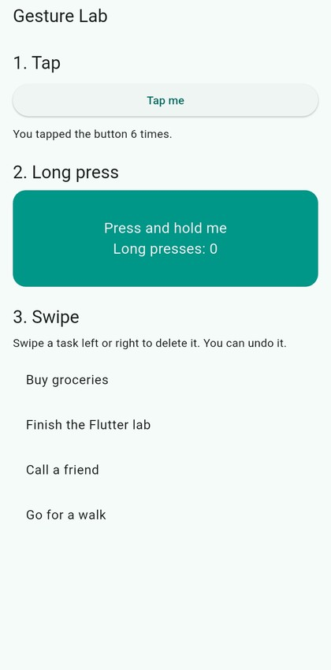
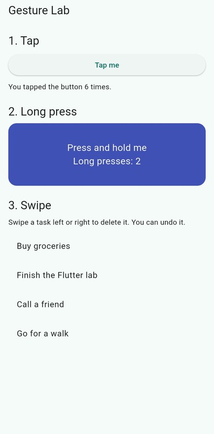
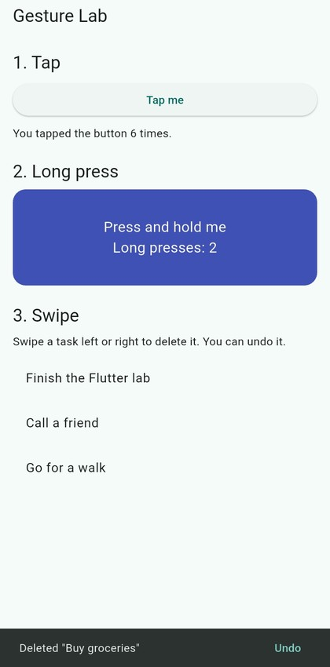
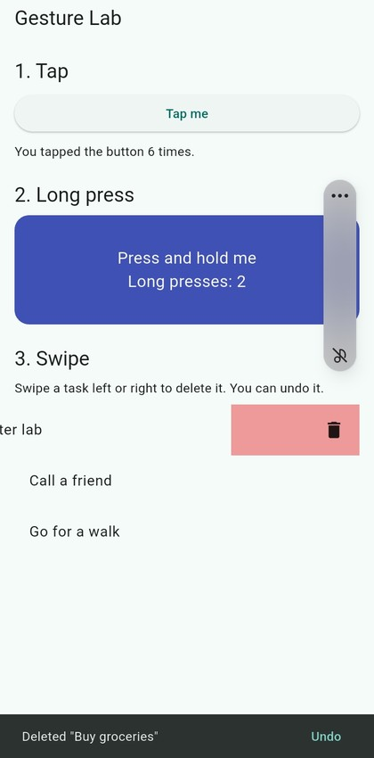
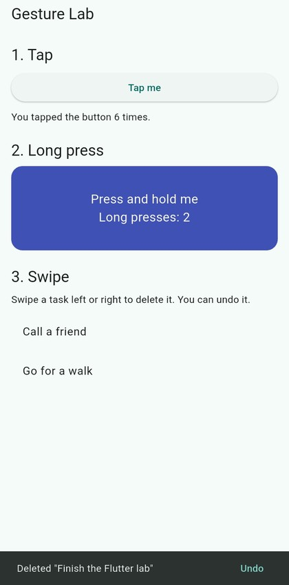
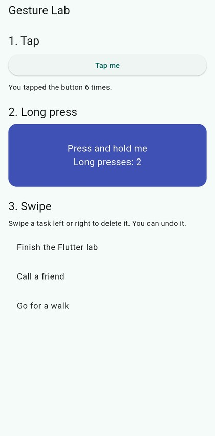

# Gesture Lab

A small Flutter app for the ITS-537 Gesture-Controlled Interface lab (Chapter 5, Responding to Gestures). It shows three gestures, and each one has a visible result.

**Author:** Rojan Shrestha, University of the Cumberlands

## Gestures

| Gesture | Widget | What happens |
|---|---|---|
| Tap | `ElevatedButton` | The counter goes up |
| Long press | `GestureDetector` (`onLongPress`) | The card changes color and the long-press count goes up |
| Swipe | `Dismissible` | The task is removed from the list |

## Refinements made after testing

Search `lib/main.dart` for `REFINEMENT` to find both changes.

1. **Undo after a swipe.** In the first version a swiped task disappeared with no way back. A message with an Undo button now appears, and tapping it puts the task back in its original place.
2. **Vibration on long press.** A short haptic pulse (`HapticFeedback.mediumImpact()`) is added when a long press is recognized.

## Screenshots

Taken on a physical Android phone (Samsung, Android 13).

**Tap and long press.** The counter shows the result of tapping. The card changes color after long presses.

<table>
  <tr>
    <td></td>
    <td></td>
  </tr>
  <tr>
    <td align="center">Start screen</td>
    <td align="center">After two long presses</td>
  </tr>
</table>

**Swipe to delete with Undo.**

<table>
  <tr>
    <td></td>
    <td></td>
    <td></td>
    <td></td>
  </tr>
  <tr>
    <td align="center">First task deleted</td>
    <td align="center">Second task mid-swipe</td>
    <td align="center">Second task deleted</td>
    <td align="center">After Undo</td>
  </tr>
</table>

## Run it

```
flutter pub get
flutter run -d <your device id>
flutter test
```
